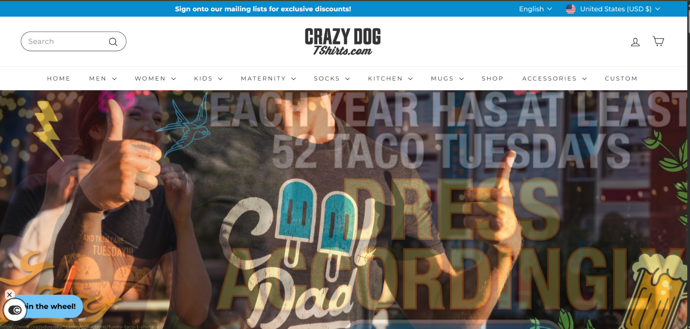
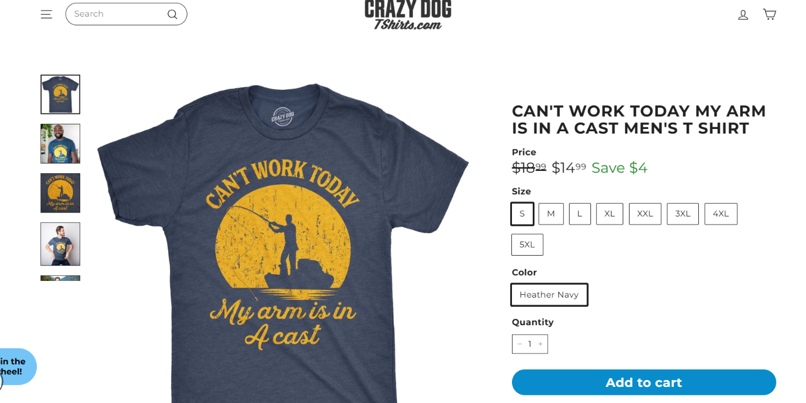
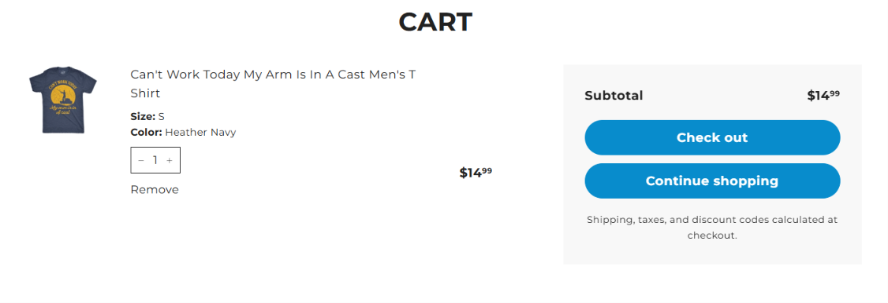
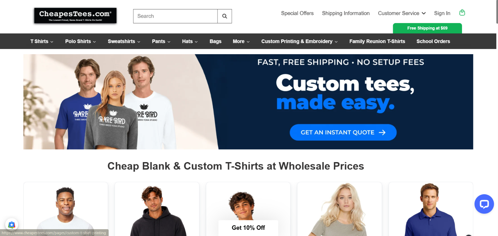
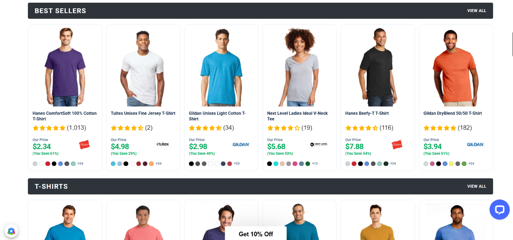
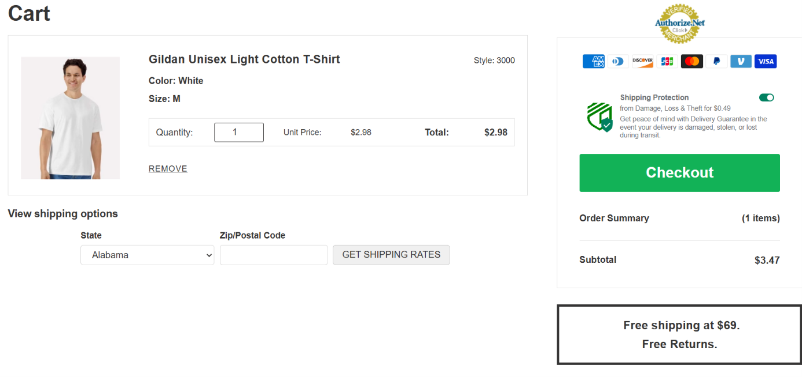
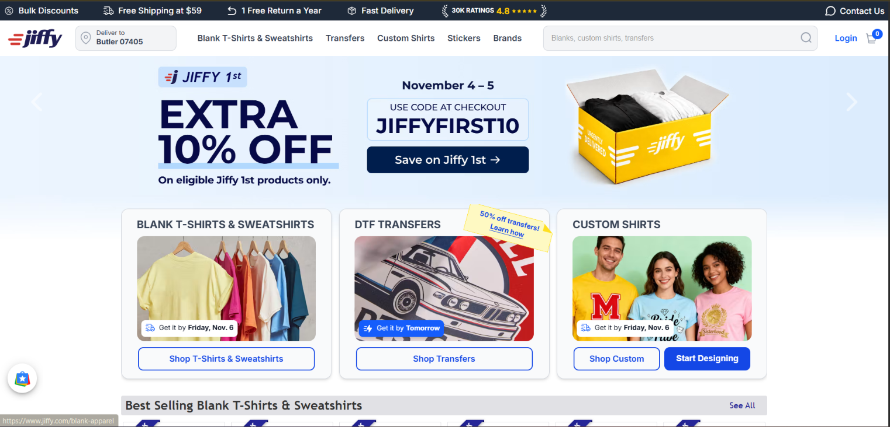
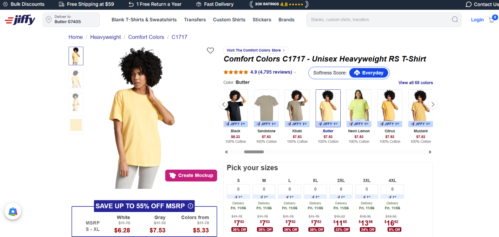
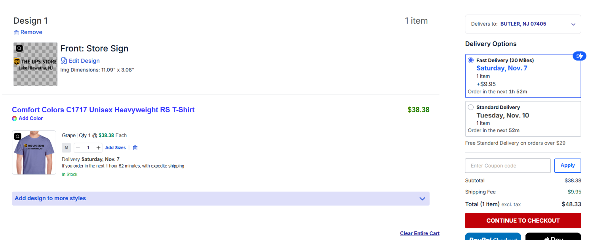

# Competitive Research Critique: T-Shirt Retailers (IS117-007)

**Student:** Jivitesh Duddu

**Research captured:** November 4–5, 2026
**Shopper scenario:** A first-time US desktop shopper near Butler, NJ (`07405`), choosing one short-sleeve crewneck in Small or Medium and proceeding from product evaluation to cart.

This document critiques evidence from three apparel retailers; it is not a review or redesign of my own website. It compares what was observed, what those observations can reasonably suggest, and where the evidence is too limited to support a stronger claim.

**Research question:** What can a first-time US desktop shopper learn about value, product choice, fit, and delivery from these retailers, and what can a short observational comparison reasonably tell me?

**Main finding:** The captured pages show different approaches: Crazy Dog emphasizes humorous graphics and promotions; CheapesTees foregrounds low-cost blanks and catalog comparison; Jiffy combines product selection with delivery and customization information. These observations suggest useful questions about clarity and persuasion, but three retailers, one shopper scenario, and a brief page audit cannot establish which approach works best or how customers behave.

**Evidence vs. assumptions:** `E01–E12`, dated page observations, and screenshot contents are the evidence recorded during the audit. Brand readings, positioning choices, personas, and design implications are interpretations or hypotheses—not verified customer research.

## At a glance

| Site | Role and example price | Look | Brand character | Persuasion cues and what it suggests |
| --- | --- | --- | --- | --- |
| [Crazy Dog T-Shirts](https://www.crazydogtshirts.com/) | Novelty graphic tees; selected shirt `$14.99` | Expressive shirt graphics in a familiar, relatively minimalist storefront | Jester | Humor and artwork add personality, but the captured pages do not establish that the overall site is postmodern. `$18.99` crossed out to `$14.99` is a price anchor, not verified regular pricing. A floating wheel prompt competes with browsing. |
| [CheapesTees](https://www.cheapestees.com/) | Wholesale blanks/custom basics; Gildan 3000 White, M: `$2.98`; `$3.47` cart subtotal | Functional, modernist catalog | Everyperson | Visible review counts aid comparison but are not independently verified. The preselected `$0.49` Shipping Protection is an opt-out cost, so show the full total and make extras opt-in. |
| [Jiffy](https://www.jiffy.com/) | Blanks/transfers/custom printing; C1717 White `$6.28` / Butter `$7.53` in the report; custom cart `$48.33` with rush delivery | Structured, with expressive custom designs | Creator | Ratings and eligible-product offers are merchant claims, not independently audited. ZIP-specific delivery details can help planning; distinguish blank, print, and delivery costs. |

Sources and page observations below were captured November 5, 2026. The products and cart configurations differ, so these prices are examples from the observed pages—not a controlled, like-for-like price comparison.

## Crazy Dog T-Shirts: expressive humor

Sources: [homepage](https://www.crazydogtshirts.com/) and [selected product page](https://www.crazydogtshirts.com/products/mens-cant-work-today-arm-is-in-a-cast-tshirt-funny-fathers-day-fishing-tee-for-guys). Captured November 5, 2026.

| Evidence | What the captured page showed | What it suggests for my project |
| --- | --- | --- |
| `E01` — Homepage | “52 Taco Tuesdays” hero, mailing-list discount bar, and a floating “Spin the wheel!” prompt. The discount amount was not checked because no email was submitted. | Distinctive humor can make a first impression, but avoid letting a pop-up compete with shopping. |
| `E02` — Category | The “Most Loved” grid showed graphic shirts at `$14.99`, crossed out from `$18.99`, with “Save $4.” | A category grid is easy to scan; the reference price should not be treated as a regular price without further evidence. |
| `E03` — Product | The selected “Can't Work Today My Arm Is In A Cast” shirt in Heather Navy, size S, showed `$14.99`; sizes `S–5XL` were visible. Fabric weight was not visible above the fold. | Put fit and material details near size selection rather than making shoppers hunt for them. |
| `E04` — Cart | One shirt showed a `$14.99` subtotal; shipping and tax were deferred to checkout. | Show an honest shipping estimate earlier in the buying journey. |

**Look:** The captured pages use a familiar, relatively minimalist e-commerce layout. The hero, playful graphics, and humor make the products expressive, but those cues alone do not establish a postmodern design approach across the website.

**Brand character (interpretation):** **Jester**, expressed through novelty and everyday humor.

**Honest persuasion:** Humor can earn attention, but avoid using an unverified comparison price as proof of savings. Keep offer terms clear and show shipping costs before checkout. “Most Loved” and review cues are merchant-provided, not independently verified.

### Evidence: Crazy Dog

More evidence: [E02 category screenshot](screenshots/e02-crazy-dog-category.png).

## CheapesTees: wholesale utility

Sources: [homepage](https://www.cheapestees.com/), [Gildan collection](https://www.cheapestees.com/collections/gildan-t-shirts), and [Gildan 3000 product page](https://www.cheapestees.com/products/gildan-unisex-light-cotton-t-shirt-3000). Captured November 5, 2026.

| Evidence | What the captured page showed | What it suggests for my project |
| --- | --- | --- |
| `E05` — Homepage | “Custom tees, made easy,” “Wholesale Prices,” and a “Free Shipping at $69” badge. | State shipping thresholds near the offer so “free shipping” is not mistaken for unconditional shipping. |
| `E06` — Category | A six-column grid showed shirt prices, review counts, and color swatches. The report text lists examples from `$2.34–$7.88`. | Structured product cards help shoppers compare styles and prices quickly. |
| `E07` — Product | Gildan 3000 in White showed `$2.98`. **The report text says the comparison price is `$5.80`, while the screenshot appears to show `$5.00`; this figure needs a recheck.** | Keep price claims verifiable and distinguish the store price from any comparison price. |
| `E08` — Cart | The `$2.98` shirt produced a `$3.47` subtotal because `$0.49` Shipping Protection was preselected. Shipping required a State/ZIP lookup. | Paid cart options should be opt-in, and all cost components should be clear. |

**Look:** A consistent catalog grid, product codes, and functional labels suggest a practical, modernist interface.

**Brand character (interpretation):** **Everyperson**, with an emphasis on utility and accessible prices.

**Honest persuasion:** Review counts are merchant-provided cues, not proof of product quality or review authenticity. State the `$69` free-shipping threshold, make paid extras opt-in, and show all cart costs clearly.

### Evidence: CheapesTees

More evidence: [E07 Gildan 3000 product screenshot](screenshots/e07-cheapestees-product.png).

## Jiffy: delivery and customization

Sources: [homepage](https://www.jiffy.com/), [Comfort Colors category](https://www.jiffy.com/brands/comfort-colors/t-shirts), and [Comfort Colors C1717 product page](https://www.jiffy.com/comfortcolors-C1717.html). Captured November 5, 2026.

| Evidence | What the captured page showed | What it suggests for my project |
| --- | --- | --- |
| `E09` — Homepage | Delivery information was localized to Butler, NJ `07405`; the page showed free shipping at `$59`, ratings, an eligible-product `10%` offer, and delivery-date cards. | Localized delivery estimates can answer a practical question early; clearly state offer eligibility. |
| `E10` — Category | Comfort Colors listings appeared with product prices, filters, and policy/delivery information. | Useful filters and policy details can aid comparison. The report's written review counts differ from the screenshot. |
| `E11` — Product | The C1717 page showed color and size choices and a “Create Mockup” action. The report text and capture differ on review counts and some extended-size prices. | Present a clear size/color price matrix, but verify details against the captured evidence before quoting exact figures. |
| `E12` — Custom cart | A custom-print item showed `$38.38`; selected Saturday Fast Delivery added `$9.95`, for a `$48.33` total. A `$0.00` Standard Delivery option was also visible. | Distinguish blank-shirt price from custom-print price, and show delivery choices and their costs together. |

**Look:** Filtering, delivery, and price information create a structured interface; custom graphics make the product experience participatory.

**Brand character (interpretation):** **Creator**, supported by a modernist shopping interface.

**Honest persuasion:** State which products qualify for offers and distinguish blank-shirt, printing, and delivery prices. Delivery estimates can reduce uncertainty, but should not be presented as guarantees beyond what the store can honor.

### Evidence: Jiffy

More evidence: [E10 Comfort Colors category screenshot](screenshots/e10-jiffy-category.png).

## Critique of the comparison

The three retailers are relevant because they represent different T-shirt shopping contexts: novelty graphics, low-cost blank apparel, and blanks/customization with delivery choices. The dated homepage, category, product, and cart observations make the comparison traceable to captured evidence. The strongest conclusions are about what information or prompts appeared in those specific page captures—not about customer satisfaction, conversion, or which retailer is objectively better.

The comparison is not like-for-like: products, prices, cart contents, and shipping thresholds differ. It is also a small, single-time snapshot of selected desktop pages for one US shopper scenario, not a representative sample of apparel stores or shoppers. Some written notes conflict with screenshots (`E07`, `E10–E11`), so affected numeric details should be rechecked before they are used as evidence. Merchant claims such as ratings, savings, and delivery estimates were not independently verified. These limits mean the observations can guide questions and hypotheses, but cannot prove that a particular design causes trust, ease, or purchase.

**Research judgment:** The evidence is useful for identifying visible tradeoffs—promotional intensity versus focus, catalog clarity versus price complexity, and delivery detail versus offer eligibility—but weak for ranking the businesses or generalizing to all shoppers. The Crazy Dog capture supports a distinction between expressive product artwork and a conventional storefront; it does not support a broad claim that the site itself is postmodern. A next research step should verify conflicting captures, compare artist/independent-design marketplaces such as [Threadless](https://www.threadless.com/) and [Redbubble](https://www.redbubble.com/) for Maya's use case, and test a 30-shirt bulk order for Marcus against quantity pricing, size/color availability, and delivered value.

## Two positions and two persona hypotheses

These are early audience and positioning hypotheses, not interview findings.

| | Position A — chosen direction | Position B — alternative |
| --- | --- | --- |
| **Position** | A clean, easy-to-scan store for expressive graphic and custom shirts, with clear fit, fabric, size pricing, and delivery information. | A utility-first wholesale store for event organizers buying 30+ matching shirts, with quantity-tier pricing, size/color availability, stock status, and a clear delivered-cost estimate. |
| **Research basis** | Uses the organized product and delivery details observed at CheapesTees and Jiffy, with expressive design inspiration from Crazy Dog. | CheapesTees provides a wholesale/catalog reference and visible unit prices, but this audit did not test quantity discounts, live inventory, or a bulk-order flow. Those capabilities are requirements to investigate, not verified competitor features. |
| **Tradeoff** | A quieter interface may feel less immediately entertaining. | Serving bulk buyers requires reliable inventory, broad size/color availability, and pricing and delivery information for the whole order. |
| **Decision** | **Chosen to test:** it addresses the prompt and checkout frictions recorded in `E01`, `E04`, and `E08`. | **Not chosen for the first version:** it is a distinct, utility-led alternative for Marcus, not a novelty-sale concept. Its operational requirements exceed the current project's scope. |

| Persona hypothesis | Situation and goal | Why this audience might fit | What remains unknown |
| --- | --- | --- | --- |
| **Maya, 20 — primary** | A creative college student or indie buyer shopping for one to three distinctive graphic/custom shirts; values original artwork, easy browsing, and fit/shrinkage information. | The proposed expressive collections and visible product details are intended to serve these needs. The current audit has no artist-marketplace comparison, so the existing three retailers do not fully represent this audience. | This is a persona hypothesis, not a real interview. Compare Threadless and Redbubble in a follow-up audit and test whether students prioritize these features and find the proposed price/value credible. |
| **Marcus, 34 — secondary** | A bulk event organizer who needs 30+ matching shirts, inclusive size/color options, dependable stock, low per-shirt cost, and a predictable delivered total. | Position B is designed around this utility-first task. The audit observed catalog and unit-price cues at CheapesTees, but did not check bulk price breaks, stock by size/color, or order fulfillment. | Competing on wholesale value may require inventory and scale beyond an initial student project. Validate a 30-shirt configuration, including size mix, quantity tiers, availability, shipping, and total cost before expanding the audience. |

**Primary audience for the first version:** creative student shoppers, represented by the Maya hypothesis. This is a project choice to test—not a claim that research participants have confirmed it.

## Brand Studio direction and assumptions

This direction reuses the [IS117 Brand Studio](https://github.com/JivExperimenters/is117-brand-studio) approach: treat audience personas as hypotheses, and make the brand's visual character and persuasion choices explicit.

- **Look:** Use a restrained, easy-to-scan shopping layout with clear product cards, whitespace, and size/price information. Let the artwork and collection copy carry the expressive character; do not describe the overall storefront as postmodern without stronger evidence.
- **Brand character:** **Creator** is the primary archetype; **Everyperson** and **Jester** are supporting influences. The voice should be creative, helpful, and approachable, with light humor.
- **Honest persuasion:** Use social proof only through genuine wearer feedback; keep product details and offer terms verifiable. Clear fit and shipping information can reduce uncertainty, but do not invent reviews, scarcity, material claims, or delivery promises.
- **Assumption 1:** Fit, fabric, and shrinkage feedback will help a first-time buyer choose a size more than a measurement chart alone.
- **Assumption 2:** Showing a shipping estimate in the cart will make total cost easier to understand.
- **Assumption 3:** A visible student offer will feel clearer than an email-gated spin wheel.

**Validation for Assumption 1:** Ask five peer shoppers to choose a size using a measurement chart, then ask what additional fit/fabric feedback changes their decision. Record whether the proposed three-part fit, softness, and durability review helps them explain their choice. This is a planned check; it has not yet been run.

## What the comparison suggests (design hypotheses)

These are implications from the comparison, not findings about my own website and not validated storefront features:

1. Keep the product grid calm and easy to scan; do not interrupt browsing with a spin-the-wheel prompt.
2. Show fabric, fit guidance, and exact size prices near the size selector.
3. Use specific, genuine wearer feedback for fit, fabric feel, and after-wash print quality; do not fabricate ratings.
4. Put shipping estimates and any optional charges in the cart, and make paid add-ons opt-in.
5. Test whether shoppers can find price, fit guidance, and estimated delivery cost in a short peer walkthrough before treating the design as effective.

## Peer feedback and decisions

The current research-round requirement is **3–5 constructive issues per classmate, per project**. Each issue should identify a specific observation, explain why it matters, and suggest a useful next step. Do not invent feedback or close an issue before a reviewer retries an accepted change.

| Issue | Feedback / decision | Change or next step | Status |
| --- | --- | --- | --- |
| [#3 — Peer review request](https://github.com/JivExperimenters/T-Shirt/issues/3) | Asked classmates to review whether the 3-bar fit/softness/durability idea helps student buyers and whether the cart shipping calculator addresses `E04`/`E08`. | Await classmate feedback; respond to each specific suggestion in the issue and update the research if warranted. | Open; review requested. |
| [#4 — Validate Assumption 1](https://github.com/JivExperimenters/T-Shirt/issues/4) | **Decision: implement.** Record a concrete peer check for the fit-review assumption while awaiting classmate feedback. | The five-peer check is described above. Run it, record what happened, and link the evidence in the issue. | Open; validation planned, not run. |
| [#12 — Crazy Dog's postmodernism](https://github.com/JivExperimenters/T-Shirt/issues/12) | **Decision: qualify the interpretation.** The captured site has a familiar, relatively minimalist layout; expressive graphics and humor are product-level cues, not enough to label the whole site postmodern. | Revised the Crazy Dog reading and brand-direction language; the design lens remains an interpretation, not a finding about the merchant's intent. | Open; wording updated locally, awaiting reviewer recheck. |
| [#13 — Competitors for Maya](https://github.com/JivExperimenters/T-Shirt/issues/13) | **Decision: add relevant follow-up candidates.** Threadless and Redbubble are included as artist/independent-design marketplace candidates, not as audited evidence. | Add both to the next comparable shopper-journey audit; capture product, fit, price, and cart evidence before drawing conclusions. | Open; follow-up research pending. |
| [#14 — Position B and Marcus](https://github.com/JivExperimenters/T-Shirt/issues/14) | **Decision: redefine Position B around Marcus's bulk utility needs.** | The alternative now specifies quantity pricing, size/color availability, stock status, and delivered value. Test a 30-shirt order; the current audit does not verify bulk tiers or inventory. | Open; position clarified locally, validation pending. |

For accepted feedback, preserve the chain **issue → decision → commit/PR → check → resolution**. Keep unfinished items open with a next step. Keep private reflections and personal eligibility circumstances in Canvas, not in this public README.

## Method, AI use, and limits

- **Method:** Inspected public US desktop pages for Crazy Dog, CheapesTees, and Jiffy on November 4–5, 2026. Recorded the homepage, category/listing, product, and cart/checkout-entry stages as `E01–E12`. Threadless and Redbubble are proposed for follow-up, not part of this evidence set. No account was created, mailing list joined, or payment submitted.
- **My work:** Selected the competitors and shopper scenario, captured the screenshots, recorded the visible page details, and chose the proposed audience and store direction.
- **AI assistance:** As disclosed in the PDF, ChatGPT and Gemini helped organize notes and screenshots into the report, systematically check Cialdini principles, separate design lenses, and format evidence-to-recommendation chains. I remain responsible for verifying and explaining the research.
- **Limits:** Shipping/tax totals were not confirmed on Crazy Dog or CheapesTees. Ratings and merchant claims were not independently audited. Prices, offers, availability, and delivery estimates may change. The personas are untested hypotheses; no conversion impact has been established.
- **Items to recheck:** The report text and screenshot differ on the CheapesTees `E07` comparison price and on some Jiffy `E10–E11` review/extended-size details. See [the full evidence gallery](./screenshots.md) and [comparison notes](./competitors.md).

## Sources and project files

- Primary sites: [Crazy Dog T-Shirts](https://www.crazydogtshirts.com/), [CheapesTees](https://www.cheapestees.com/), and [Jiffy](https://www.jiffy.com/).
- Frameworks: [Pearson archetypes](https://carolspearson.com/about/the-pearson-12-archetype-system-human-development-and-evolution), [Cialdini principles](https://cialdini.com/principles), and V&A on [Modernism](https://www.vam.ac.uk/articles/what-was-modernism) and [Postmodernism](https://www.vam.ac.uk/articles/what-is-postmodernism).
- [Full competitive research report (PDF)](IS117_TShirt_Competitive_Research_Report_Jivitesh_Duddu.docx.pdf)
- [Screenshot gallery and captions](./screenshots.md) · [Method and limitations](./methodology.md) · [Website specifications](./specifications.md)

The VitePress documentation source is in this repository. GitHub Pages publishing still requires the deployment workflow to be added and enabled; this README does not claim the documentation site is live.
