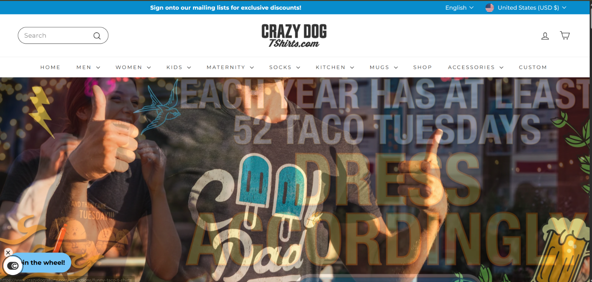
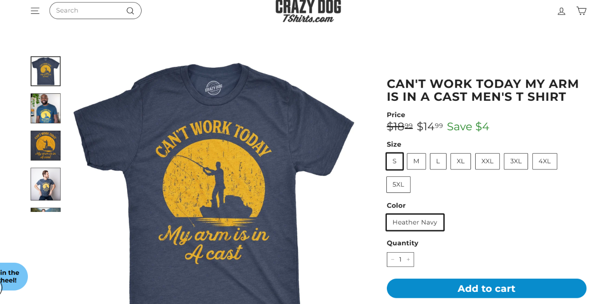
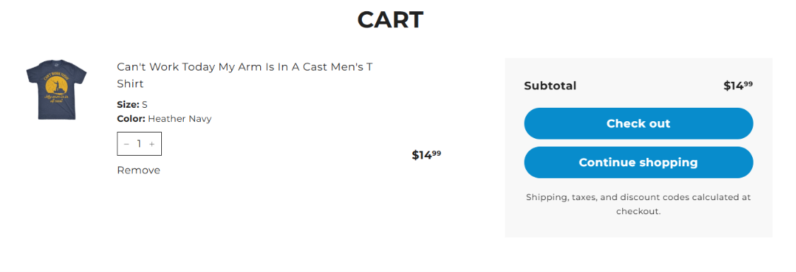
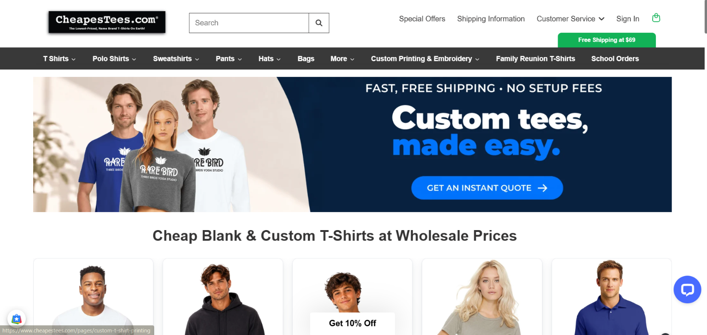
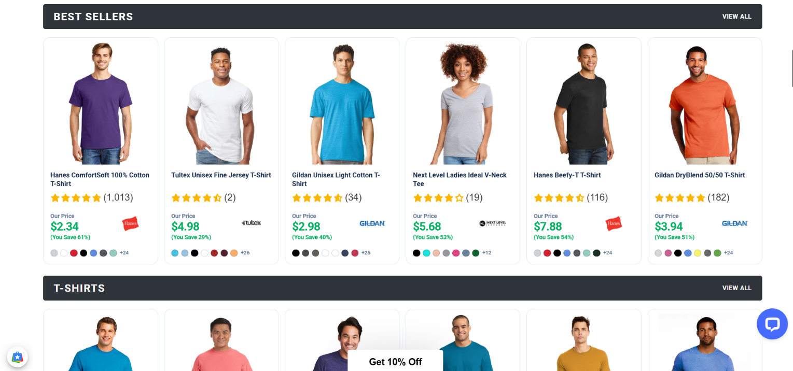
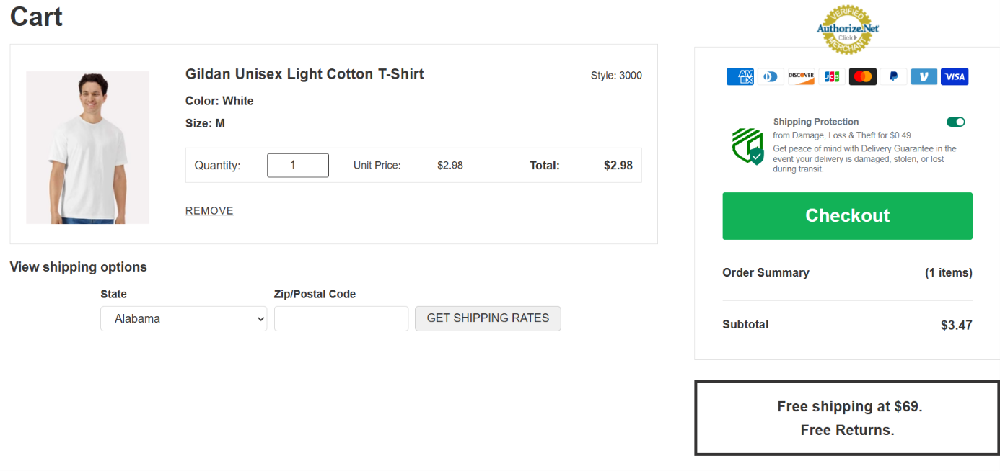
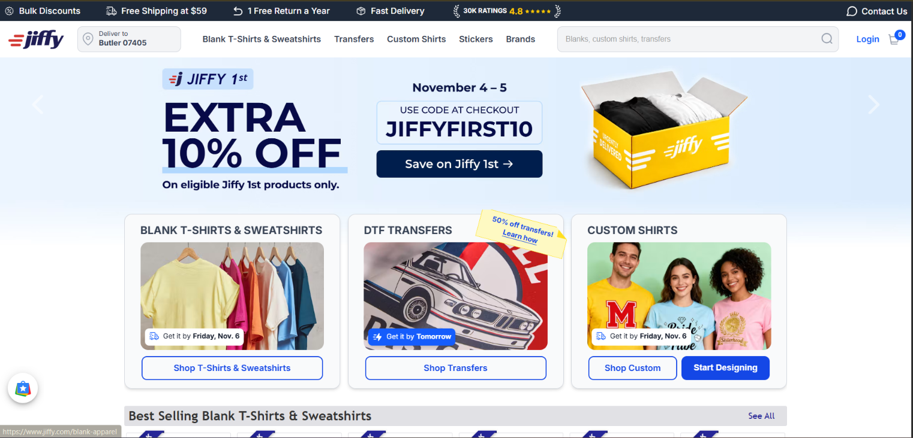
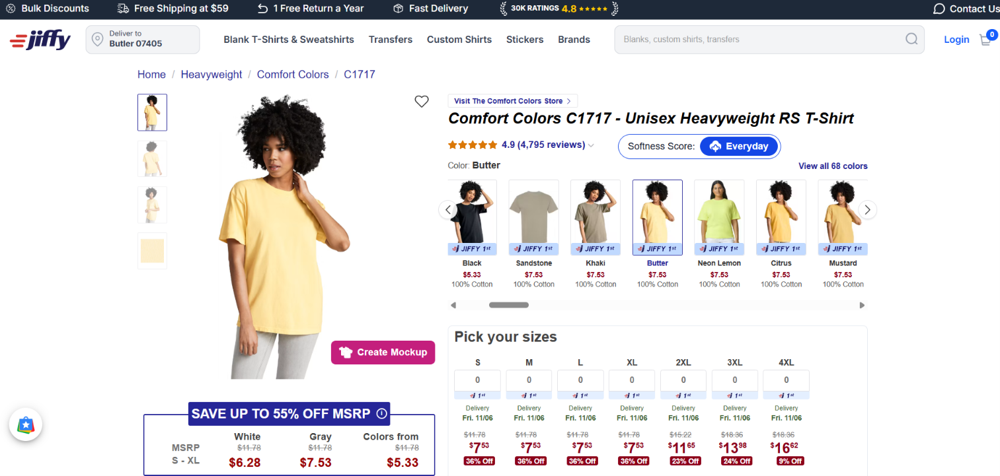
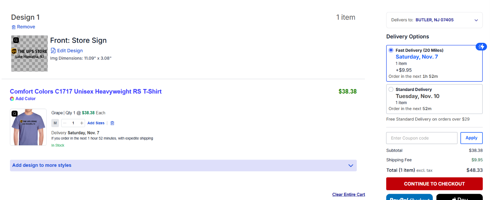

# Competitive Research Critique: T-Shirt Retailers (IS117-007)

**Student:** Jivitesh Duddu

**Research captured:** November 4–5, 2026  
**Shopper scenario:** A first-time US desktop shopper near Butler, NJ (`07405`), choosing one short-sleeve crewneck in Small or Medium and proceeding from product evaluation to cart.

This document critiques evidence from three apparel retailers; it is not a review or redesign of my own website. It compares what was observed, what those observations can reasonably suggest, and where the evidence is too limited to support a stronger claim. All numeric values below have been reconciled directly against the November 5, 2026 screenshot captures (`E01–E12`).

**Research question:** What can a first-time US desktop shopper learn about value, product choice, fit, and delivery from these retailers, and what can a short observational comparison reasonably tell me?

**Main finding:** The captured pages show different approaches: Crazy Dog emphasizes humorous graphics and promotions; CheapesTees foregrounds low-cost blanks and catalog comparison; Jiffy combines product selection with delivery and customization information. These observations suggest useful questions about clarity and persuasion, but three retailers, one shopper scenario, and a brief page audit cannot establish which approach works best or how customers behave.

**Evidence vs. assumptions:** `E01–E12`, dated page observations, and screenshot contents are the evidence recorded during the audit. Brand readings, positioning choices, personas, and design implications are interpretations or hypotheses—not verified customer research.

## At a glance

| Site | Role and example price (reconciled with captures) | Look | Brand character | Persuasion cues and what it suggests |
| --- | --- | --- | --- | --- |
| [Crazy Dog T-Shirts](https://www.crazydogtshirts.com/) | Novelty graphic tees; selected shirt `$14.99` (grid shows `$14.98–$14.99` vs. `$18.99`) | Expressive shirt graphics in a familiar, relatively minimalist storefront | Jester | Humor and artwork add personality, but the captured pages do not establish that the overall site is postmodern. `$18.99` crossed out to `$14.98–$14.99` is a price anchor, not verified regular pricing. A floating wheel prompt competes with browsing. |
| [CheapesTees](https://www.cheapestees.com/) | Wholesale blanks/custom basics; Gildan 3000 White, M: `$2.98` (vs. `$5.00` "Price Seen Elsewhere", `34` reviews); `$3.47` cart subtotal | Functional, modernist catalog | Everyperson | Visible review counts (`2` to `1,013` on the Best Sellers grid; `34` on Gildan 3000) aid comparison but are not independently verified. The preselected `$0.49` Shipping Protection is an opt-out cost, so show the full total and make extras opt-in. |
| [Jiffy](https://www.jiffy.com/) | Blanks/transfers/custom printing; C1717 `S–XL`: `$5.33` Black / `$6.28` White / `$7.53` Butter (`4,795` reviews; `2XL $11.65`, `3XL $13.98`, `4XL $16.62`); custom cart `$48.33` with rush delivery | Structured, with expressive custom designs | Creator | Sitewide ratings (`30K RATINGS 4.8`), product reviews (`4,795` on C1717), and eligible-product offers are merchant claims, not independently audited. ZIP-specific delivery details can help planning; distinguish blank, print, and delivery costs. |

Sources and page observations below were captured November 5, 2026. The products and cart configurations differ, so these prices are examples from the observed pages—not a controlled, like-for-like price comparison.

## Crazy Dog T-Shirts: expressive humor

Sources: [homepage](https://www.crazydogtshirts.com/) and [selected product page](https://www.crazydogtshirts.com/products/mens-cant-work-today-arm-is-in-a-cast-tshirt-funny-fathers-day-fishing-tee-for-guys). Captured November 5, 2026.

| Evidence | What the captured page showed | What it suggests for my project |
| --- | --- | --- |
| `E01` – Homepage | “52 Taco Tuesdays” hero, mailing-list discount bar, and a floating “Spin the wheel!” prompt. The discount amount was not checked because no email was submitted. | Distinctive humor can make a first impression, but avoid letting a pop-up compete with shopping. |
| `E02` – Category | The “Most Loved” 5-column grid showed graphic shirts with green `SALE` badges: four top-row shirts listed `$14.99` crossed out from `$18.99` (`Save $4`), and one shirt (*“That Sounds Like A Horrible Idea. What Time?”*) listed `$14.98` crossed out from `$18.99` (`Save $4.01`). Star ratings are not displayed on the captured grid cards. | A category grid is easy to scan; the reference price should not be treated as a regular price without further evidence. |
| `E03` – Product | The selected “Can’t Work Today My Arm Is In A Cast” shirt in Heather Navy, size S, showed `$14.99` (crossed out from `$18.99`, `Save $4`); sizes `S–5XL` were visible. Fabric weight was not visible above the fold. | Put fit and material details near size selection rather than making shoppers hunt for them. |
| `E04` – Cart | One shirt showed a `$14.99` subtotal; shipping, taxes, and discount codes were deferred to checkout. | Show an honest shipping estimate earlier in the buying journey. |

**Look:** The captured pages use a familiar, relatively minimalist e-commerce layout. The hero, playful graphics, and humor make the products expressive, but those cues alone do not establish a postmodern design approach across the website.

**Brand character (interpretation):** **Jester**, expressed through novelty and everyday humor.

**Honest persuasion:** Humor can earn attention, but avoid using an unverified comparison price as proof of savings. Keep offer terms clear and show shipping costs before checkout. “Most Loved” cues are merchant-provided, not independently verified.

### Evidence: Crazy Dog

More evidence: [E02 category screenshot](screenshots/e02-crazy-dog-category.png).

## CheapesTees: wholesale utility

Sources: [homepage](https://www.cheapestees.com/), [Gildan collection](https://www.cheapestees.com/collections/gildan-t-shirts), and [Gildan 3000 product page](https://www.cheapestees.com/products/gildan-unisex-light-cotton-t-shirt-3000). Captured November 5, 2026.

| Evidence | What the captured page showed | What it suggests for my project |
| --- | --- | --- |
| `E05` – Homepage | “Custom tees, made easy,” “Wholesale Prices,” a “Free Shipping at $69” badge, and a bottom “Get 10% Off” tab. | State shipping thresholds near the offer so “free shipping” is not mistaken for unconditional shipping. |
| `E06` – Category | A six-column “Best Sellers” grid showed exact unit prices, star ratings, review counts, and color swatches: Hanes ComfortSoft (`$2.34`, Save `61%`, `1,013` reviews), Tultex Fine Jersey (`$4.98`, Save `29%`, `2` reviews), Gildan Light Cotton (`$2.98`, Save `40%`, `34` reviews), Next Level Ladies V-Neck (`$5.68`, Save `53%`, `19` reviews), Hanes Beefy-T (`$7.88`, Save `54%`, `116` reviews), and Gildan DryBlend 50/50 (`$3.94`, Save `51%`, `182` reviews). | Structured product cards help shoppers compare styles, prices, and review volume quickly. |
| `E07` – Product | Gildan Unisex Light Cotton T-Shirt (`Style 3000`) in White showed **`$2.98`** (`You Save: 40%`), **`Price Seen Elsewhere: $5.00`**, and **`34` reviews** above `XS–4XL` quantity input boxes. *(Reconciled with capture `E07`: an earlier PDF draft misread the comparison price as `$5.80 / 49%` and review count as `38`; the captured page shows `$5.00`, `40%`, and `34` reviews).* | Keep price claims verifiable and distinguish the store price from any comparison price. |
| `E08` – Cart | The `$2.98` shirt (White, Size M, Qty 1) produced a **`$3.47` subtotal** because **`$0.49` Shipping Protection** was preselected by default. Shipping required a State (`Alabama` default) and ZIP lookup. | Paid cart options should be opt-in, and all cost components should be clear. |

**Look:** A consistent catalog grid, product codes, and functional labels suggest a practical, modernist interface.

**Brand character (interpretation):** **Everyperson**, with an emphasis on utility and accessible prices.

**Honest persuasion:** Review counts (`34` on Gildan 3000; `1,013` on Hanes ComfortSoft) are merchant-provided cues, not proof of product quality or review authenticity. State the `$69` free-shipping threshold, make paid extras opt-in, and show all cart costs clearly.

### Evidence: CheapesTees

More evidence: [E07 Gildan 3000 product screenshot](screenshots/e07-cheapestees-product.png).

## Jiffy: delivery and customization

Sources: [homepage](https://www.jiffy.com/), [Comfort Colors category](https://www.jiffy.com/brands/comfort-colors/t-shirts), and [Comfort Colors C1717 product page](https://www.jiffy.com/comfortcolors-C1717.html). Captured November 5, 2026.

| Evidence | What the captured page showed | What it suggests for my project |
| --- | --- | --- |
| `E09` – Homepage | Delivery information was localized to Butler, NJ `07405`; the top bar shows `Free Shipping at $59`, `1 Free Return a Year`, **`30K RATINGS 4.8`**, an `EXTRA 10% OFF` banner (`JIFFYFIRST10`, Nov 4–5, on eligible Jiffy 1st products only), and delivery-date cards (`Get it by Friday, Nov. 6` / `Tomorrow`). | Localized delivery estimates can answer a practical question early; clearly state offer eligibility. |
| `E10` – Category | The “Comfort Colors T-Shirts in Bulk” grid (`10 results`) showed policy badges (`BULK DISCOUNT AT $99`, `FREE SHIPPING AT $59*`, `FREE FIRST RETURN ON BLANK ITEMS WITHIN 100 DAYS`) and five visible cards: **C1717 (`$7.53`, `4,795` reviews)**, **C6014 (`$15.09`, `1,362` reviews)**, **C9018 (`$5.95`, `679` reviews)**, **3023CL (`$10.93`, `124` reviews)**, and **CC1745 (`$12.82`, `324` reviews)**. *(Reconciled with capture `E10`: C1717 displays `4,795` reviews, not `9,708`).* | Useful filters and policy details can aid comparison when review counts and return conditions are stated accurately. |
| `E11` – Product | The Comfort Colors C1717 page (in `Butter`) showed **`4.9 (4,795 reviews)`**, a `Softness Score: Everyday` badge, a “Create Mockup” button, color tier pricing (`S–XL` vs. `$11.78` MSRP: **`White $6.28`**, **`Gray $7.53`**, **`Colors from $5.33`** such as `Black $5.33`), and per-size prices for `Butter` (`Delivery Fri. 11/06`): **`S–XL $7.53`** (`36% Off` `$11.78`), **`2XL $11.65`** (`23% Off` `$15.22`), **`3XL $13.98`** (`24% Off` `$18.36`), and **`4XL $16.62`** (`9% Off` `$18.36`). *(Reconciled with capture `E11`: replaced earlier PDF draft typos of `9,708` reviews and `$11.15 / $13.38 / $14.37` extended-size prices).* | Present a clear size/color price matrix so extended-size upcharges (`2XL–4XL`) are visible before clicking “Add to cart.” |
| `E12` – Custom cart | A custom-print C1717 (`Grape`, Size M, `Front: Store Sign`, `Img Dimensions: 11.09" x 3.08"`) showed **`$38.38`**; selected `Fast Delivery (20 Miles)` for `Saturday, Nov. 7` (`Order in the next 1h 52m`) added **`$9.95`**, for a **`$48.33` Total (excl. tax)**. A `Standard Delivery` option for `Tuesday, Nov. 10` (`Order in the next 52m`, `Free Standard Delivery on orders over $29`) was also visible. | Distinguish blank-shirt price from custom-print price, and show delivery choices and their costs together. |

**Look:** Filtering, delivery, and price information create a structured interface; custom graphics make the product experience participatory.

**Brand character (interpretation):** **Creator**, supported by a modernist shopping interface.

**Honest persuasion:** State which products qualify for offers and distinguish blank-shirt, printing, and delivery prices. Delivery estimates can reduce uncertainty, but should not be presented as guarantees beyond what the store can honor.

### Evidence: Jiffy

More evidence: [E10 Comfort Colors category screenshot](screenshots/e10-jiffy-category.png).

## Critique of the comparison

The three retailers are relevant because they represent different T-Shirt shopping contexts: novelty graphics, low-cost blank apparel, and blanks/customization with delivery choices. The dated homepage, category, product, and cart observations make the comparison traceable to captured evidence. The strongest conclusions are about what information or prompts appeared in those specific page captures—not about customer satisfaction, conversion, or which retailer is objectively better.

The comparison is not like-for-like: products, prices, cart contents, and shipping thresholds differ. It is also a small, single-time snapshot of selected desktop pages for one US shopper scenario, not a representative sample of apparel stores or shoppers. Earlier transcription discrepancies between the initial PDF prose and screenshots (`E06–E07` comparison price `$5.00` and `34` reviews; `E09–E12` sitewide `30K` ratings, C1717 `4,795` reviews, and `Butter` extended-size prices `2XL $11.65`, `3XL $13.98`, `4XL $16.62`) have now been fully reconciled against the captured images. Merchant claims such as ratings, savings, and delivery estimates were not independently verified.

**Research judgment:** The evidence is useful for identifying visible tradeoffs—promotional intensity versus focus, catalog clarity versus price complexity, and delivery detail versus offer eligibility—but weak for ranking the businesses or generalizing to all shoppers. The Crazy Dog capture supports a distinction between expressive product artwork and a conventional storefront; it does not support the broad claim that the site itself is postmodern. A next research step should compare artist/independent-design marketplaces such as [Threadless](https://www.threadless.com/) and [Redbubble](https://www.redbubble.com/) for Maya's use case, and test a 30-shirt bulk order for Marcus against quantity pricing, size/color availability, and delivered value.

## Two positions and two persona hypotheses

These are early audience and positioning hypotheses, not interview findings.

| | Position A – chosen direction | Position B – alternative |
| --- | --- | --- |
| **Core positioning** | Indie-design T-Shirt shop for students and young creatives who want expressive artwork, transparent pricing, and reliable fit/delivery info. | Wholesale and custom blank-tee store focused on low per-unit pricing and bulk volume. |
| **Why it might work** | Directly connects to the evidence from all three sites: artwork and humor (Crazy Dog), transparent product specs (CheapesTees), and delivery clarity (Jiffy). | Matches CheapesTees' blank-pricing model and Jiffy's customization/delivery workflows, though this audit did not test quantity discounts, live inventory, or a bulk-order flow. Those capabilities are requirements to investigate, not verified competitor features. |
| **Main tradeoff** | Narrows the audience and relies on original designs; a `$14.99–$24.99` price range and fit/shipping clarity are design targets to test, not proven customer preferences. | Competes on low margins and bulk fulfillment, which is harder for an early-stage student project. |
| **Decision** | **Chosen** for the first version because it is testable and realistic. | **Not chosen** as the primary concept. Its operational requirements exceed the current project's scope. |

| Persona hypothesis | Situation and goal | Why this audience might fit | What remains unknown |
| --- | --- | --- | --- |
| **Maya (creative student, 20)** – Wants a distinctive graphic tee for class and weekend wear without hidden fees or sizing guesswork. | Restrained storefront, clear sizing, and visible product details are intended to serve these needs. The current audit has no artist-marketplace comparison, so the existing three retailers do not fully represent this audience. | This is a persona hypothesis, not a real interview. Compare Threadless and Redbubble in a follow-up audit and test whether students prioritize these features and find the proposed price/value credible. |
| **Marcus (club organizer, 24)** – Needs ~30 shirts for a campus event and prioritizes clear unit pricing, color/size availability, and delivery dates. | Selected for a bulk-order task. The audit observed catalog and unit-price cues at CheapesTees, but did not check bulk price breaks, stock by size/color, or order fulfillment. | Competing on wholesale value may require inventory and scale beyond an initial student project. Validate a 30-shirt bulk order configuration, including size mix, quantity tiers, availability, shipping, and total cost before expanding the audience. |

**Primary audience for the first version:** creative student shoppers, represented by the Maya hypothesis. This is a project choice to test—not a claim that research participants have confirmed it.

## Brand Studio direction and assumptions

This direction reuses the [IS117 Brand Studio](https://github.com/JivExperimenters/is117-brand-studio) approach: treat audience personas as hypotheses, and make the brand's visual character and persuasion choices explicit.

- **Look:** Use a restrained, easy-to-scan shopping layout with clear product cards, whitespace, and size/price information. Let the artwork and collection copy carry the expressive character; do not describe the overall storefront as postmodern without stronger evidence.
- **Brand character:** **Creator** is the primary archetype; **Everyperson** and **Jester** are supporting influences. The voice should be creative, helpful, and approachable, with light humor.
- **Honest persuasion:** Use social proof only through genuine wearer feedback; keep product details and offer terms verifiable. Clear fit and shipping information can reduce uncertainty, but do not invent reviews, scarcity, material claims, or delivery promises.
- **Assumption 1:** Fit, fabric, and shrinkage feedback will help a first-time buyer choose a size more than a measurement chart alone.
- **Assumption 2:** Showing a shipping estimate in the cart will make total cost easier to understand.
- **Assumption 3:** A visible student offer will feel clearer than an email-gated spin wheel.
- **Assumption 4:** A brief fit/fabric/delivery review helps them explain their choice. This is a planned check; it has not yet been run.

## What the comparison suggests (design hypotheses)

These are implications from the comparison, not findings about my own website and not validated storefront features:

1. Keep the product grid calm and easy to scan; do not interrupt browsing with a spin-the-wheel prompt.
2. Show fabric, fit guidance, and exact size prices near the size selector.
3. Use specific, genuine wearer feedback for fit, fabric feel, and after-wash print quality; do not fabricate ratings.
4. Put shipping estimates and any optional charges in the cart, and make paid add-ons opt-in.
5. Test whether shoppers can find price, fit guidance, and estimated delivery cost in a short peer walkthrough before treating the design as effective.

## Peer feedback and decisions (Matched to GitHub Issues & Reviewer Retry Status)

The table below matches the exact issue numbers and states in [JivExperimenters/T-Shirt/issues](https://github.com/JivExperimenters/T-Shirt/issues?q=is%3Aissue+state%3Aclosed) while explicitly noting where classmate reviewer retry (`@mnguyenht`) or follow-up validation is still pending:

| GitHub Issue & Author | Feedback / Decision | Linked Change & Next Step | GitHub State & Reviewer Retry Status |
| --- | --- | --- | --- |
| **[#3 — Peer review request & open question: Fit slider vs. size chart](https://github.com/JivExperimenters/T-Shirt/issues/3)** (`@JivExperimenters`) | **Implement:** Requested peer review on whether the 3-bar fit/softness/durability summary and cart shipping calculator address `E03`, `E04`, and `E08`. | Translated into testable specifications in [`specifications.md`](./specifications.md) and [`plan.md`](./plan.md). | **Closed on GitHub;** 5-peer classroom walkthrough validation still **pending execution**. |
| **[#4 — Add validation test for Assumption 1](https://github.com/JivExperimenters/T-Shirt/issues/4)** (`@JivExperimenters`) | **Implement:** Added a concrete 5-peer walkthrough protocol to test Assumption 1 (fit summary vs. measurement chart). | Documented the 5-peer check in `README.md`, [`specifications.md`](./specifications.md), and [`plan.md`](./plan.md). | **Closed on GitHub;** planned 5-peer walkthrough is **pending execution** (not yet an observed result). |
| **[#10 — Add Model Dimensions to Size picker](https://github.com/JivExperimenters/T-Shirt/issues/10)** (`@JivExperimenters`) | **Implement:** Include reviewer height and size ordered alongside fit feedback only when genuinely provided by the reviewer. | Added height/size attribution rule to Row 3 of [`specifications.md`](./specifications.md) and the SQLite `reviews` table in [`plan.md`](./plan.md). | **Closed on GitHub;** specification updated, peer walkthrough **pending**. |
| **[#12 — 1, crazy dog T-shirts are not postmodernism](https://github.com/JivExperimenters/T-Shirt/issues/12)** (`@mnguyenht`) | **Implement (Qualify interpretation):** Agreed that Crazy Dog's page template is a familiar, relatively minimalist e-commerce layout while the expressive cues live in the shirt graphics and humor. | Updated `README.md`, [`competitors.md`](./competitors.md), and [`plan.md`](./plan.md) (PRs `#8–#9`, commit `8d5270b`) to distinguish storefront layout from product artwork. | **Closed on GitHub;** documentation updated, **reviewer `@mnguyenht` retry/confirmation still pending**. |
| **[#13 — 2, most competitors might not sell to Maya](https://github.com/JivExperimenters/T-Shirt/issues/13)** (`@mnguyenht`) | **Implement (Add follow-up scope):** Agreed that CheapesTees and Jiffy focus on blanks/custom orders; added [Threadless](https://www.threadless.com/) and [Redbubble](https://www.redbubble.com/) as follow-up artist-marketplace candidates without treating them as captured Nov 5 evidence. | Added follow-up audit row in [`specifications.md`](./specifications.md) and audience scope notes in `README.md` and [`competitors.md`](./competitors.md). | **Closed on GitHub;** scope updated, **follow-up Threadless/Redbubble capture and `@mnguyenht` retry still pending**. |
| **[#14 — 3, position B does full match Marcus yet](https://github.com/JivExperimenters/T-Shirt/issues/14)** (`@mnguyenht`) | **Implement (Redefine Position B):** Reframed Position B around Marcus's bulk-buying utility (30+ shirt quantity tiers, size/color stock availability, and delivered value) rather than novelty sales. | Updated Position B in `README.md`, [`competitors.md`](./competitors.md), and Row 5 of [`specifications.md`](./specifications.md). | **Closed on GitHub;** Position B updated, **30-shirt bulk validation test and `@mnguyenht` retry still pending**. |

* **Outgoing Peer-Review Issues Filed on Partner Repo (`mnguyenht/is117-tshirt-research`):** [Issue #1](https://github.com/mnguyenht/is117-tshirt-research/issues/1) (*Add Model Dimensions to Size picker*), [Issue #2](https://github.com/mnguyenht/is117-tshirt-research/issues/2) (*Highlight our clean, fee-free checkout*), and [Issue #3](https://github.com/mnguyenht/is117-tshirt-research/issues/3) (*Keep and test the post modernist aesthethic*).

## Method, AI use, and limits

- **Method:** Inspected public US desktop pages for Crazy Dog, CheapesTees, and Jiffy on November 4–5, 2026. Recorded the homepage, category/listing, product, and cart/checkout-entry stages as `E01–E12`. Threadless and Redbubble are proposed for follow-up, not part of this evidence set. No account was created, mailing list joined, or payment submitted.
- **My work:** Selected the competitors and shopper scenario, captured the screenshots, reconciled all price and review-count figures against the captures, and chose the proposed audience and store direction.
- **AI assistance:** ChatGPT and Gemini helped organize notes and screenshots into the report, systematically check Cialdini principles, reconcile transcription discrepancies against `E01–E12`, and format the VitePress documentation. I remain responsible for verifying and explaining the research.
- **Limits:** Shipping/tax totals were not confirmed on Crazy Dog or CheapesTees. Ratings and merchant claims were not independently audited. Prices, offers, availability, and delivery estimates may change. The personas are untested hypotheses; no conversion impact has been established.

## Sources and project files

- **Retailers:** [Crazy Dog T-Shirts](https://www.crazydogtshirts.com/), [CheapesTees](https://www.cheapestees.com/), and [Jiffy](https://www.jiffy.com/).
- **Frameworks:** [Brand Archetypes](https://carolspearson.com/about/the-pearson-12-archetype-system-human-development-and-evolution), [Cialdini principles](https://cialdini.com/principles), and V&A on [Modernism](https://www.vam.ac.uk/articles/what-was-modernism) and [Postmodernism](https://www.vam.ac.uk/articles/what-is-postmodernism).
- **Store Plan & SQLite Architecture (Nov 17):** [plan.md](./plan.md)
- **Evidence gallery:** [screenshots.md](./screenshots.md)
- **Comparison notes:** [competitors.md](./competitors.md)
- **Methodology:** [methodology.md](./methodology.md)
- **Specifications:** [specifications.md](./specifications.md)
- **Peer feedback log:** [peer-feedback.md](./peer-feedback.md)
