# Screenshot evidence

The following 12 screenshots were extracted from the research report PDF. They document public desktop pages inspected during the November 4–5, 2026 audit; the screenshots themselves are dated November 5. Each caption gives the evidence ID, page stage, and exact reconciled figures visible in the capture.

The images show third-party retailer websites and are included as attributed research evidence. Observations describe what appeared in the captured pages; retailer claims and prices were not independently verified beyond those captures.

## Crazy Dog T-Shirts

### E01 – Homepage

[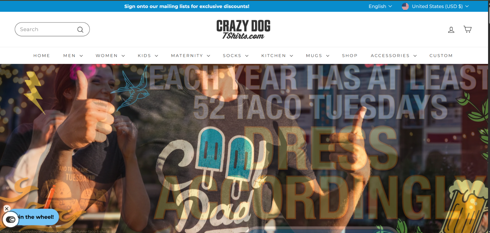](https://github.com/JivExperimenters/T-Shirt/blob/main/screenshots/e01-crazy-dog-homepage.png)

Captured November 5, 2026. Shows the “EACH YEAR HAS AT LEAST 52 TACO TUESDAYS / DRESS ACCORDINGLY” hero banner, top mailing-list bar, and bottom-left “Spin the wheel!” prompt. The discount amount requires email submission and was not checked.

### E02 – “Most Loved” category

[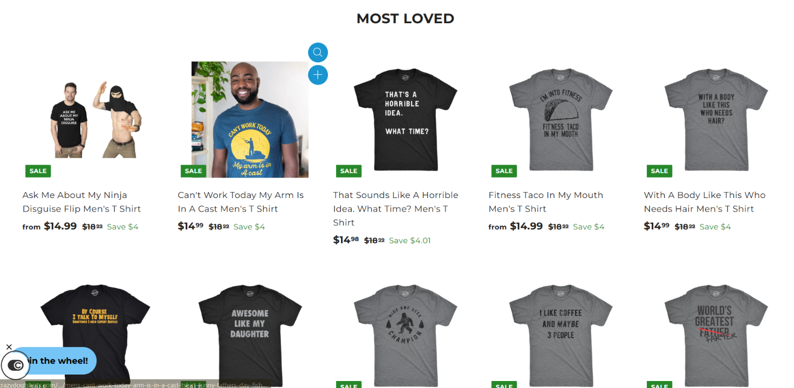](https://github.com/JivExperimenters/T-Shirt/blob/main/screenshots/e02-crazy-dog-category.png)

Captured November 5, 2026. Four top-row shirts show `$14.99` crossed out from `$18.99` (`Save $4`), and the middle shirt (*“That Sounds Like A Horrible Idea. What Time?”*) shows `$14.98` crossed out from `$18.99` (`Save $4.01`). The displayed `$18.99` reference price was not verified as a regular price, and star ratings are not shown on the grid cards.

### E03 – Product page

[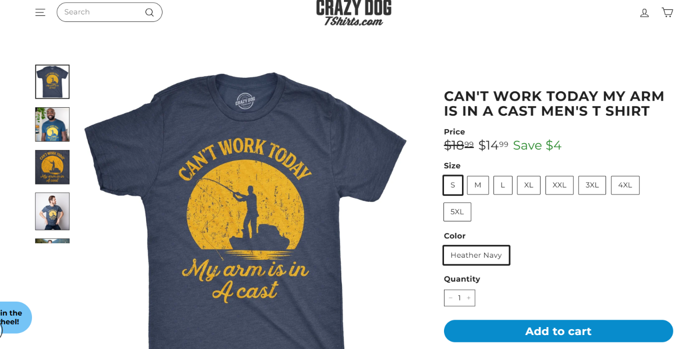](https://github.com/JivExperimenters/T-Shirt/blob/main/screenshots/e03-crazy-dog-product.png)

Captured November 5, 2026. Shows the selected Heather Navy shirt in Size S at `$14.99` (`$18.99` crossed out, `Save $4`) with sizes `S–5XL`; fabric weight and shipping are not visible above the fold.

### E04 – Cart

[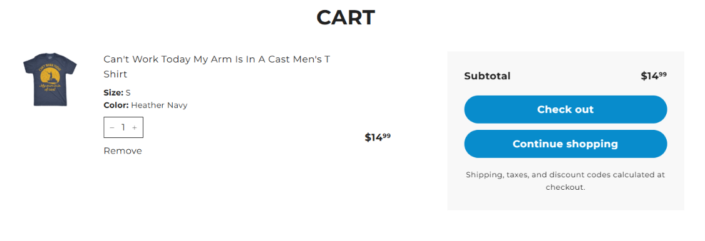](https://github.com/JivExperimenters/T-Shirt/blob/main/screenshots/e04-crazy-dog-cart.png)

Captured November 5, 2026. Subtotal is `$14.99` for 1 shirt (Size S, Heather Navy); shipping, taxes, and discount codes are deferred to checkout.

## CheapesTees

### E05 – Homepage

[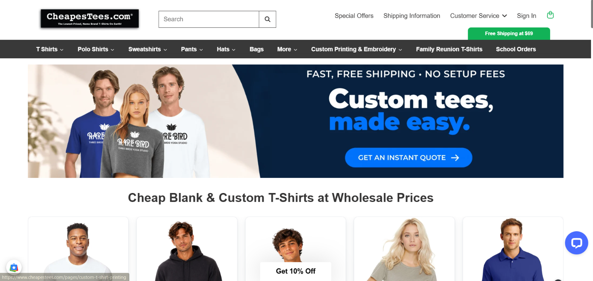](https://github.com/JivExperimenters/T-Shirt/blob/main/screenshots/e05-cheapestees-homepage.png)

Captured November 5, 2026. The “FAST, FREE SHIPPING - NO SETUP FEES” banner is qualified by the top-right green badge reading “Free Shipping at $69”.

### E06 – Best-sellers category

[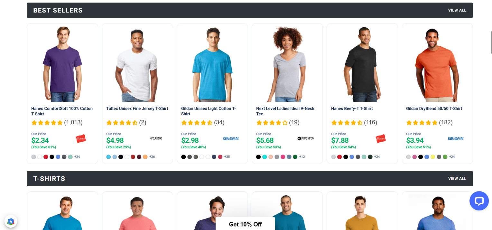](https://github.com/JivExperimenters/T-Shirt/blob/main/screenshots/e06-cheapestees-category.png)

Captured November 5, 2026. Displays six products with exact unit prices, savings percentages, and review counts: Hanes ComfortSoft (`$2.34`, Save `61%`, `1,013` reviews), Tultex Fine Jersey (`$4.98`, Save `29%`, `2` reviews), Gildan Light Cotton (`$2.98`, Save `40%`, `34` reviews), Next Level Ladies V-Neck (`$5.68`, Save `53%`, `19` reviews), Hanes Beefy-T (`$7.88`, Save `54%`, `116` reviews), and Gildan DryBlend 50/50 (`$3.94`, Save `51%`, `182` reviews).

### E07 – Gildan 3000 product page

[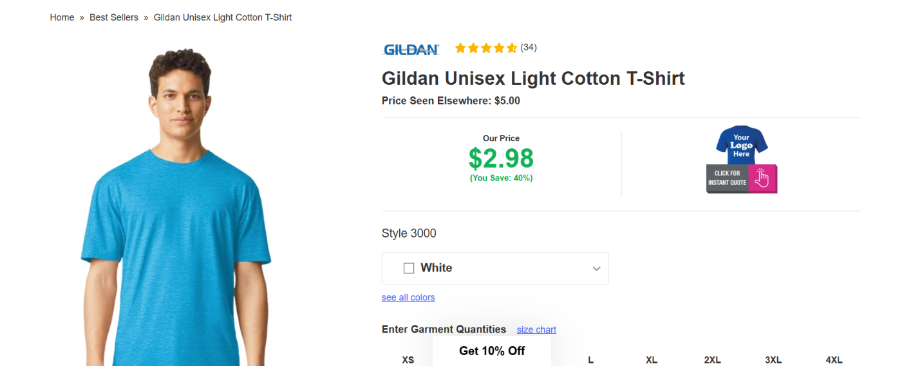](https://github.com/JivExperimenters/T-Shirt/blob/main/screenshots/e07-cheapestees-product.png)

Captured November 5, 2026. Displays `Gildan Unisex Light Cotton T-Shirt` (`Style 3000`, White) with **`(34)` reviews**, **`Price Seen Elsewhere: $5.00`**, and **`Our Price: $2.98 (You Save: 40%)`**. *(Reconciled directly from this capture, correcting the `$5.80 / 49% / 38 reviews` typo in the initial PDF text).*

### E08 – Cart

[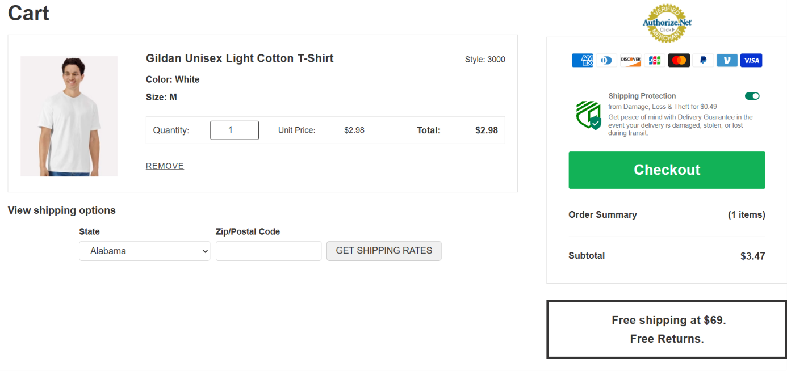](https://github.com/JivExperimenters/T-Shirt/blob/main/screenshots/e08-cheapestees-cart.png)

Captured November 5, 2026. The `$2.98` item (White, Size M, Qty 1) and preselected `$0.49` Shipping Protection toggle produce a `$3.47` subtotal; the shipping rate still requires a State (`Alabama` default) and ZIP lookup.

## Jiffy

### E09 – Homepage

[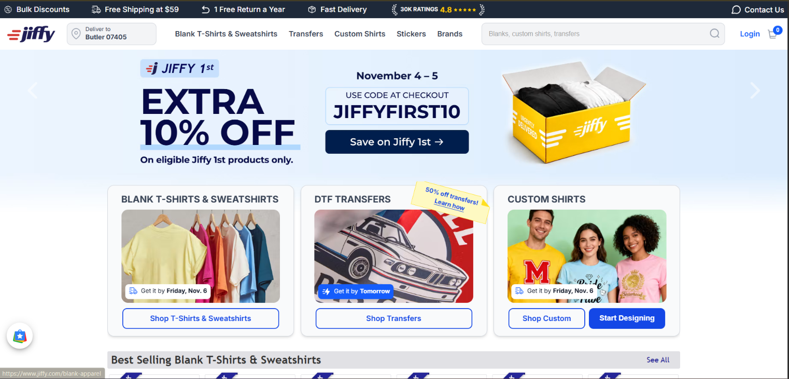](https://github.com/JivExperimenters/T-Shirt/blob/main/screenshots/e09-jiffy-homepage.png)

Captured November 5, 2026. Localized to `Butler 07405`, showing `Free Shipping at $59`, `1 Free Return a Year`, **`30K RATINGS 4.8`**, and `EXTRA 10% OFF` (`JIFFYFIRST10`, Nov 4–5, on eligible Jiffy 1st products only).

### E10 – Comfort Colors category

[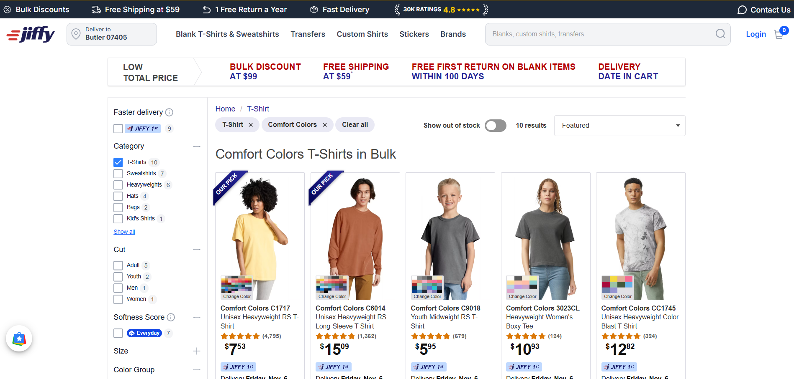](https://github.com/JivExperimenters/T-Shirt/blob/main/screenshots/e10-jiffy-category.png)

Captured November 5, 2026. Shows `Comfort Colors C1717` at **`$7.53`** with **`(4,795)` reviews**, alongside `C6014` (`$15.09`, `1,362` reviews), `C9018` (`$5.95`, `679` reviews), `3023CL` (`$10.93`, `124` reviews), and `CC1745` (`$12.82`, `324` reviews). *(Reconciled directly from this capture, correcting the `9,708` review count from the initial PDF text).*

### E11 – Comfort Colors C1717 product page

[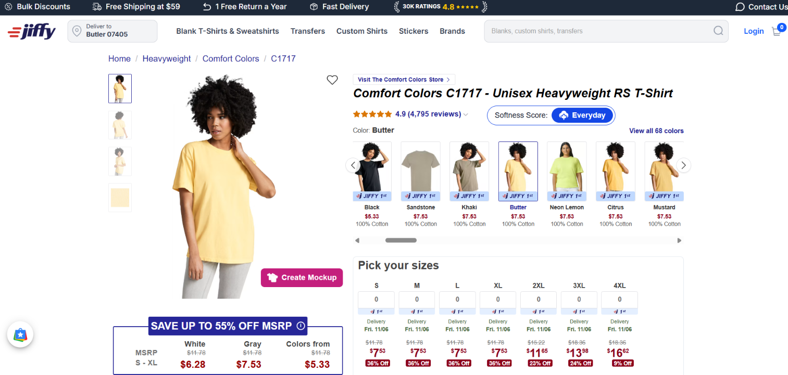](https://github.com/JivExperimenters/T-Shirt/blob/main/screenshots/e11-jiffy-product.png)

Captured November 5, 2026. Shows `Comfort Colors C1717` in `Butter` with **`4.9 (4,795 reviews)`**, color tier box (`S–XL` vs. `$11.78` MSRP: `White $6.28`, `Gray $7.53`, `Colors from $5.33` including `Black $5.33`), and exact `Butter` size prices (`Delivery Fri. 11/06`): **`S–XL $7.53`** (`36% Off` `$11.78`), **`2XL $11.65`** (`23% Off` `$15.22`), **`3XL $13.98`** (`24% Off` `$18.36`), and **`4XL $16.62`** (`9% Off` `$18.36`). *(Reconciled directly from this capture).*

### E12 – Custom cart

[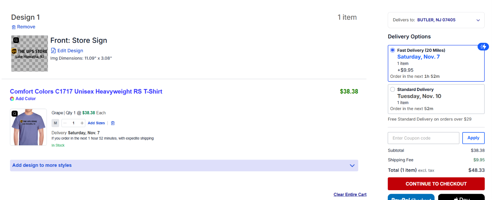](https://github.com/JivExperimenters/T-Shirt/blob/main/screenshots/e12-jiffy-cart.png)

Captured November 5, 2026. A `$38.38` custom-print C1717 (`Grape`, Size M, `Front: Store Sign`, `11.09" x 3.08"`) plus selected `$9.95` `Fast Delivery (20 Miles)` for `Saturday, Nov. 7` (`Order in the next 1h 52m`) totals **`$48.33` (excl. tax)**; the screenshot also shows a `Standard Delivery` option (`Tuesday, Nov. 10`, `Order in the next 52m`, `Free Standard Delivery on orders over $29`).
