# Screenshot evidence

The following 12 screenshots were extracted from the provided research report PDF. They document public desktop pages inspected during the November 4–5, 2026 audit; the screenshots themselves are dated November 5. Each caption gives the evidence ID, page stage, and relevant observation or limitation.

The images show third-party retailer websites and are included as attributed research evidence. Observations describe what appeared in the captured pages; retailer claims and prices were not independently verified beyond those captures.

## Crazy Dog T-Shirts

### E01 — Homepage

[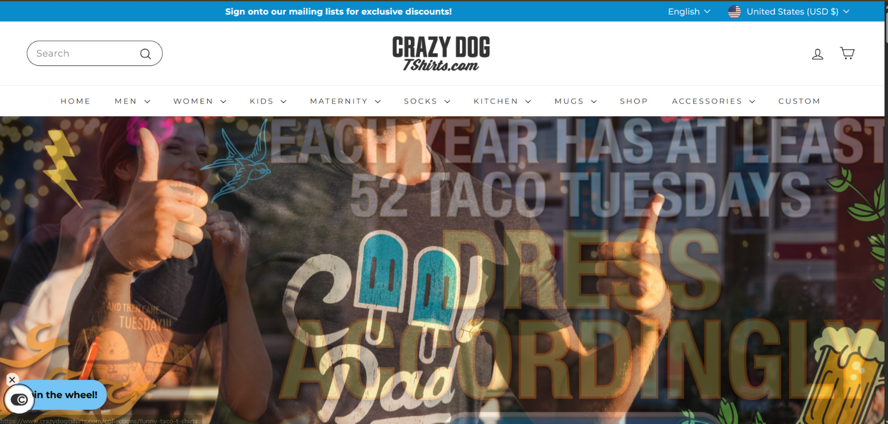](https://github.com/JivExperimenters/T-Shirt/blob/main/screenshots/e01-crazy-dog-homepage.png)

Captured November 5, 2026. The discount amount requires email submission and was not checked.

### E02 — “Most Loved” category

[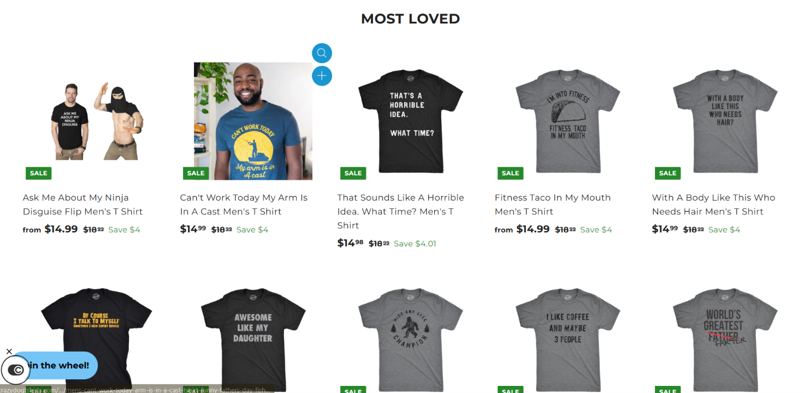](https://github.com/JivExperimenters/T-Shirt/blob/main/screenshots/e02-crazy-dog-category.png)

Captured November 5, 2026. The displayed `$18.99` reference price was not verified as a regular price.

### E03 — Product page

[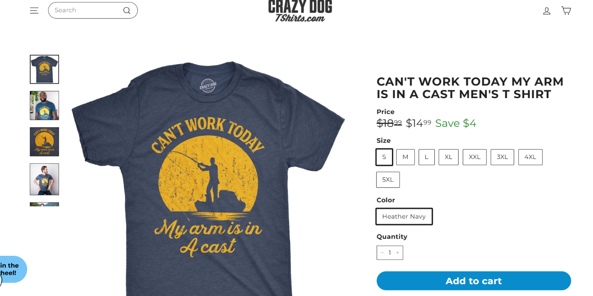](https://github.com/JivExperimenters/T-Shirt/blob/main/screenshots/e03-crazy-dog-product.png)

Captured November 5, 2026. The page shows the selected Heather Navy shirt at `$14.99`; fabric weight and shipping are not visible above the fold.

### E04 — Cart

[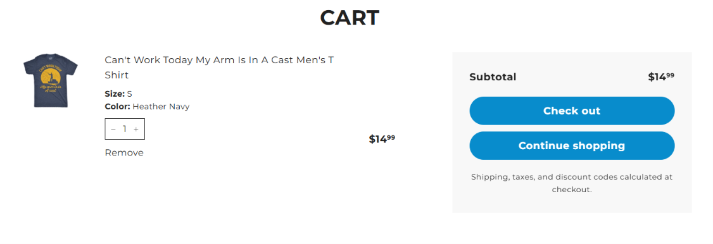](https://github.com/JivExperimenters/T-Shirt/blob/main/screenshots/e04-crazy-dog-cart.png)

Captured November 5, 2026. Shipping and taxes are deferred to checkout.

## CheapesTees

### E05 — Homepage

[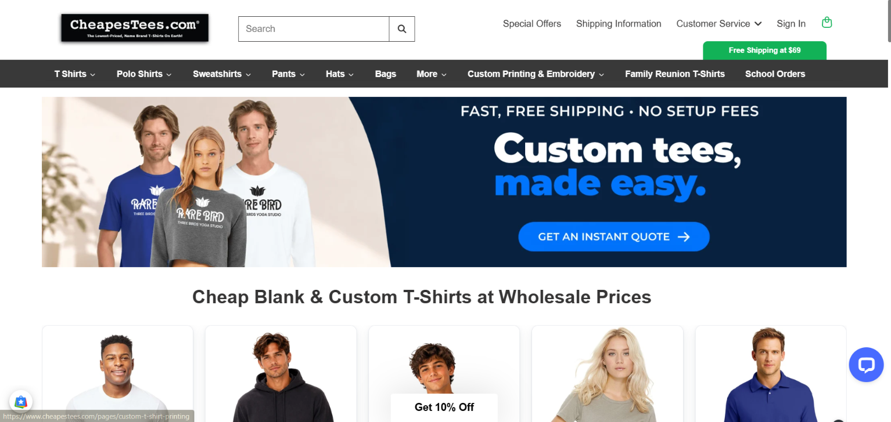](https://github.com/JivExperimenters/T-Shirt/blob/main/screenshots/e05-cheapestees-homepage.png)

Captured November 5, 2026. The free-shipping offer is qualified by the `$69` minimum.

### E06 — Best-sellers category

[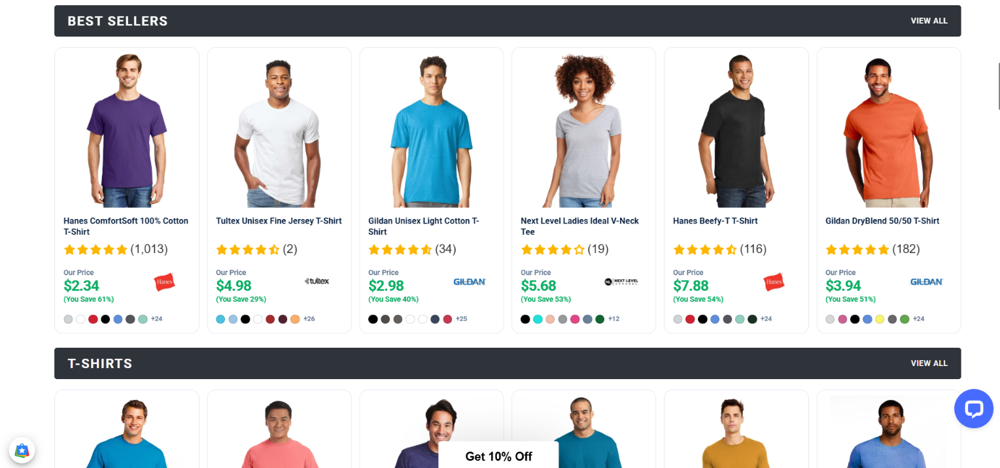](https://github.com/JivExperimenters/T-Shirt/blob/main/screenshots/e06-cheapestees-category.png)

Captured November 5, 2026. The report's written record and the displayed product details should be treated as a dated snapshot.

### E07 — Gildan 3000 product page

[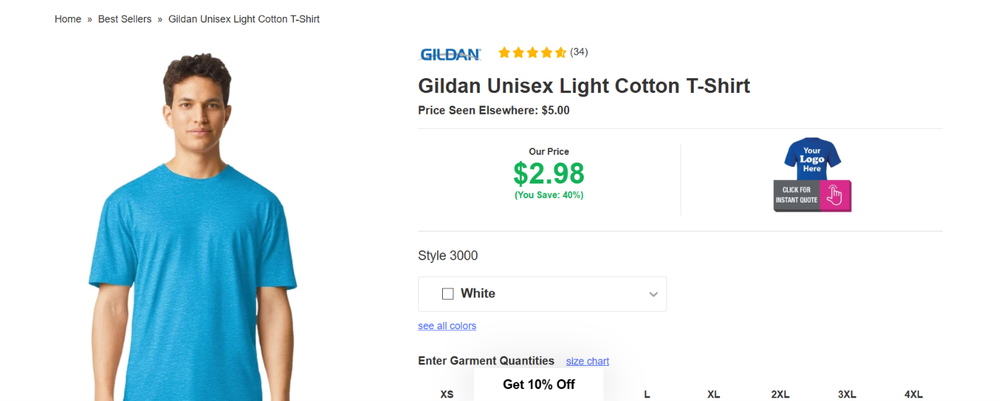](https://github.com/JivExperimenters/T-Shirt/blob/main/screenshots/e07-cheapestees-product.png)

Captured November 5, 2026. The written report says the comparison price is `$5.80`; this screenshot appears to show `$5.00`. Recheck before using the comparison figure.

### E08 — Cart

[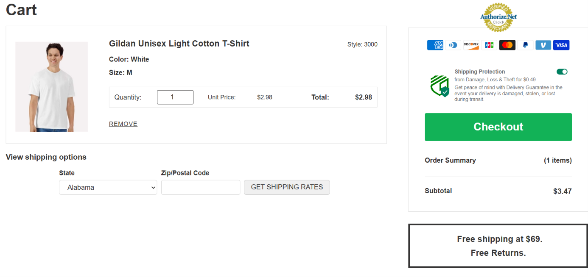](https://github.com/JivExperimenters/T-Shirt/blob/main/screenshots/e08-cheapestees-cart.png)

Captured November 5, 2026. The `$2.98` item and preselected `$0.49` Shipping Protection produce a `$3.47` subtotal; the shipping rate still requires a ZIP lookup.

## Jiffy

### E09 — Homepage

[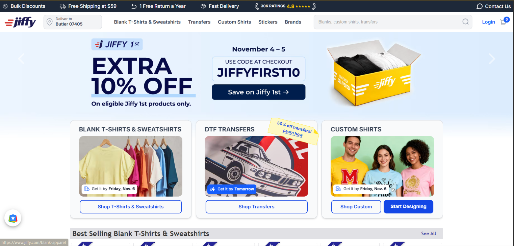](https://github.com/JivExperimenters/T-Shirt/blob/main/screenshots/e09-jiffy-homepage.png)

Captured November 5, 2026. The `10%` code is shown for eligible Jiffy 1st products only.

### E10 — Comfort Colors category

[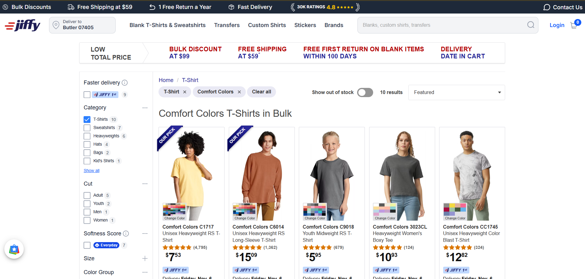](https://github.com/JivExperimenters/T-Shirt/blob/main/screenshots/e10-jiffy-category.png)

Captured November 5, 2026. Review counts differ between the written record and capture; verify before quoting them.

### E11 — Comfort Colors C1717 product page

[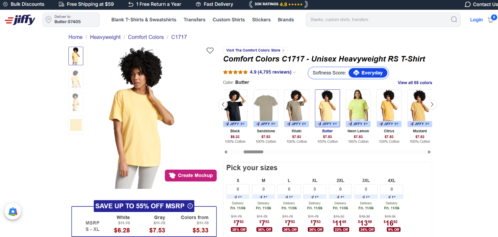](https://github.com/JivExperimenters/T-Shirt/blob/main/screenshots/e11-jiffy-product.png)

Captured November 5, 2026. The written report's review count and some extended-size prices differ from this screenshot.

### E12 — Custom cart

[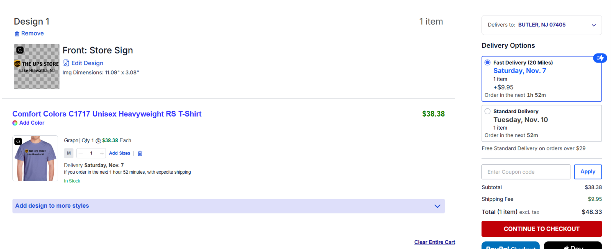](https://github.com/JivExperimenters/T-Shirt/blob/main/screenshots/e12-jiffy-cart.png)

Captured November 5, 2026. A `$38.38` custom-print item plus the selected `$9.95` Saturday delivery totals `$48.33`; the screenshot also shows a `$0.00` Standard Delivery option.
